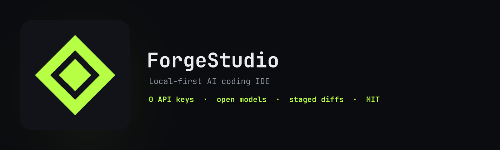
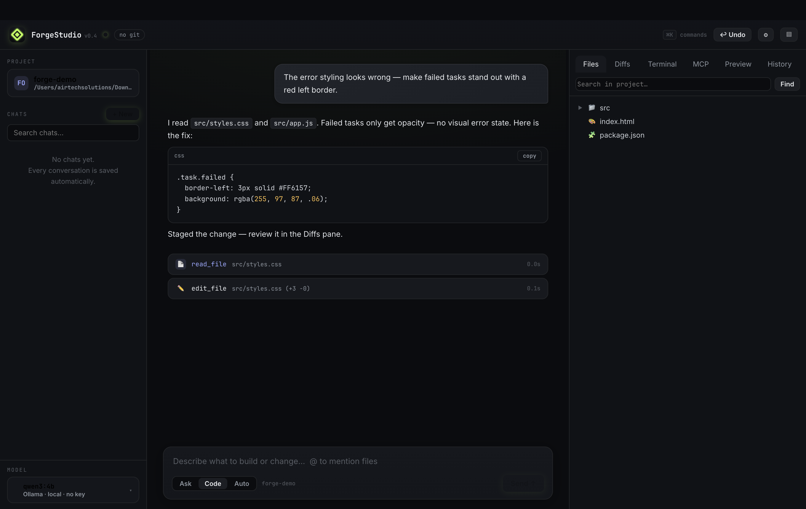
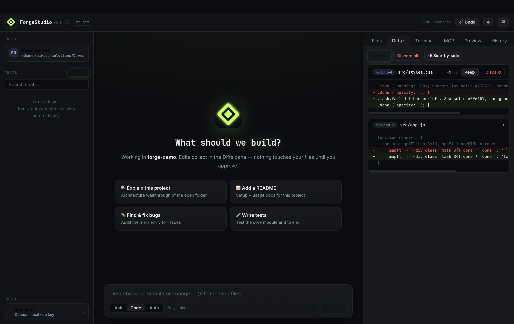
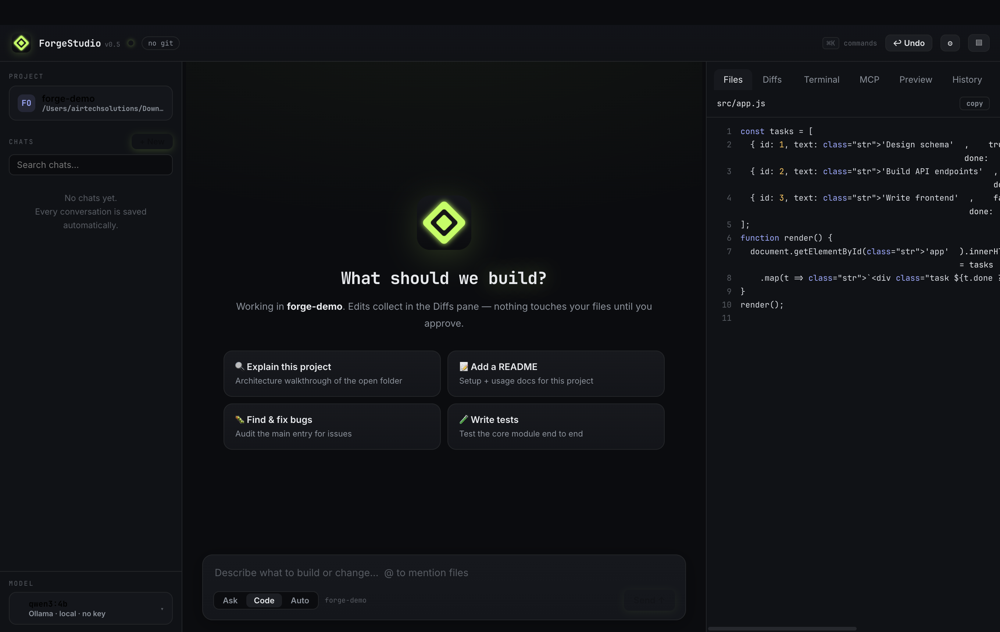
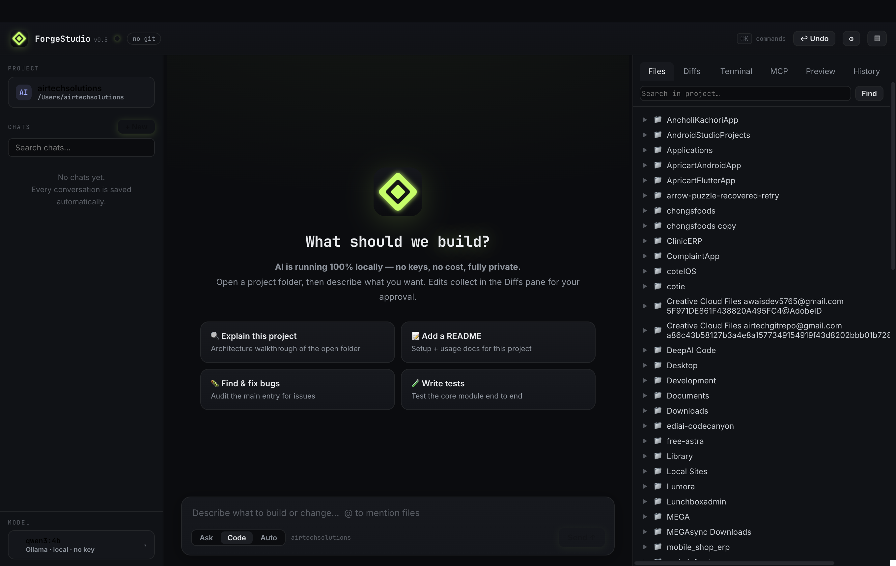
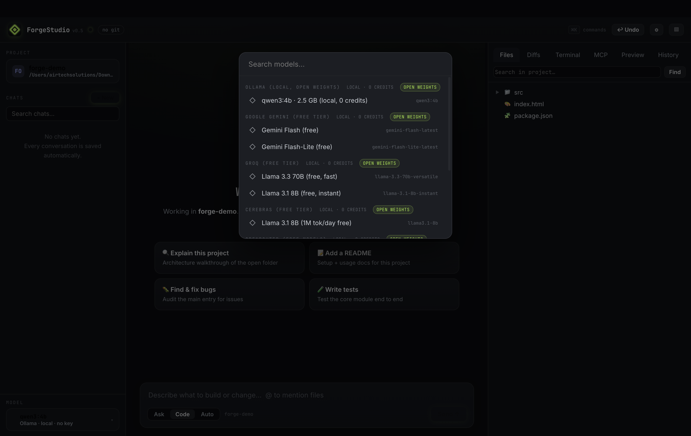
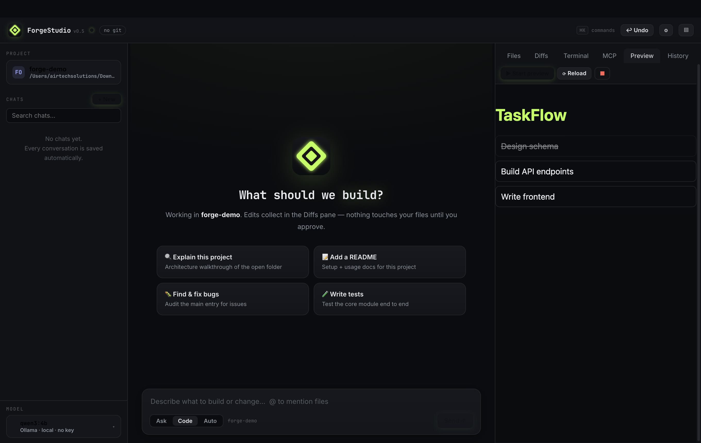
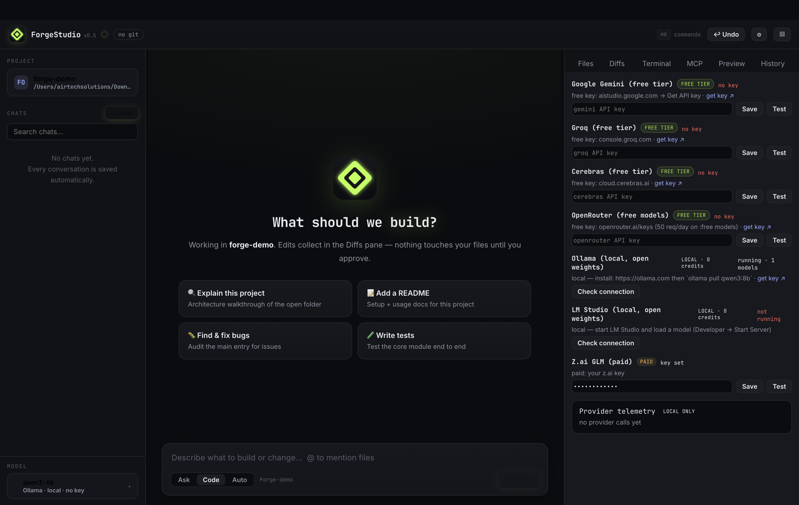
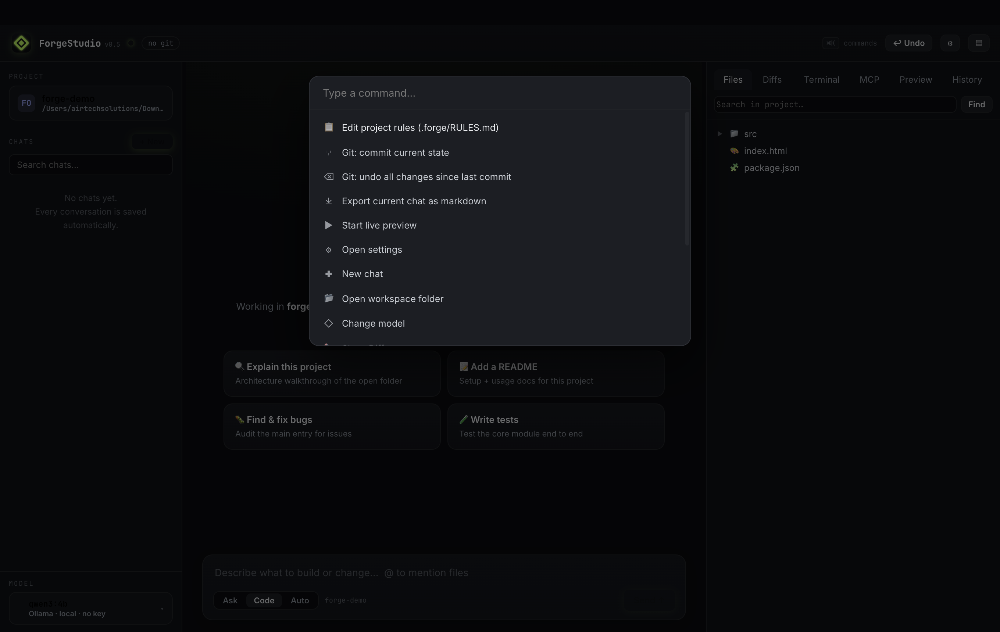
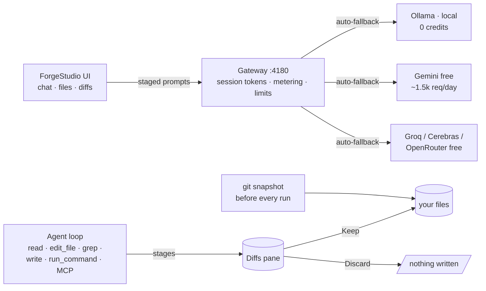

<div align="center">
  
  
  [](https://www.npmjs.com/package/forge-agent-core)
  
  
  [](#)

  **A coding agent IDE that runs on your machine — with AI that needs no API keys.**
  
  Open-weights local models by default. Free cloud tiers as backup. Every edit reviewed before it touches disk.
</div>

---

## Why ForgeStudio

| | ForgeStudio | Typical AI IDE |
|---|---|---|
| **AI cost** | **$0** — local Ollama models, 0 credits | $10–20/mo subscription |
| **API keys** | **Not required** | Required |
| **Privacy** | Code never leaves your Mac (local mode) | Sent to cloud |
| **Edits** | Staged diffs — nothing writes until you **Keep** | Varies |
| **Safety net** | Git commit before every run + checkpoints | Varies |
| **Model choice** | Any OpenAI-compatible provider, auto-fallback | Locked to vendor |

## ✨ Features

- 🔑 **Zero-key AI** — [Ollama](https://ollama.com) models run locally (private, free). Optional free-tier keys (Gemini / Groq / Cerebras / OpenRouter) for backup, never required
- 🛡️ **Staged diff review** — the agent stages every change; you Keep / Discard per file, or all at once
- ⏪ **Two-layer undo** — git snapshot before every run *and* file checkpoints; restore any point
- 🧠 **Crafted agent prompts** — per-mode (Ask / Code / Auto), workspace-aware, honors `.forge/RULES.md` project rules
- 🔧 **Real tools** — read, write, targeted `edit_file`, project-wide `grep`, shell (Auto mode, blocklisted dangerous commands), **MCP servers**
- 📡 **Streaming + auto-fallback** — token-by-token output; if a provider is rate-limited it silently switches to the next free one
- 🖼 **Vision** — paste screenshots into chat (multimodal models)
- 🌐 **Live preview** — web projects served inside the app
- ⌨️ **Command palette** (⌘K), searchable chat history, markdown export, project-aware suggestions

## 📸 Screenshots

<table>
<tr>
<td width="50%" align="center"><br><sub><b>Agent chat</b> — streaming markdown, tool steps with durations</sub></td>
<td width="50%" align="center"><br><sub><b>Staged diffs</b> — Keep/Discard per file, side-by-side toggle</sub></td>
</tr>
<tr>
<td width="50%" align="center"><br><sub><b>Files</b> — lazy tree, syntax-highlighted viewer, project search</sub></td>
<td width="50%" align="center"><br><sub><b>Welcome</b> — keyless AI detected automatically</sub></td>
</tr>
<tr>
<td width="50%" align="center"><br><sub><b>Model picker</b> — grouped by provider with LOCAL / FREE badges</sub></td>
<td width="50%" align="center"><br><sub><b>Preview</b> — web projects served live inside the app</sub></td>
</tr>
<tr>
<td width="50%" align="center"><br><sub><b>Keys</b> — test connections, telemetry (local only)</sub></td>
<td width="50%" align="center"><br><sub><b>⌘K palette</b> — every action one keystroke away</sub></td>
</tr>
</table>

## 🚀 Quick start

```bash
# 1 · Install Ollama (free, no account) and pull an open model
#    https://ollama.com/download
ollama pull qwen3:4b        # 2.5 GB · or a bigger model for faster/better runs

# 2 · Download ForgeStudio
#    → GitHub Releases (DMG / portable exe)
#    First launch on macOS: right-click → Open (unsigned build)

# 3 · Open a project folder, describe what you want.
#    Edits collect in the Diffs pane — Keep or Discard.
```

> Prefer cloud free-tier? Get a key at [aistudio.google.com](https://aistudio.google.com/apikey) (~1,500 req/day, no card) and paste it in the **Keys** pane. Total free stack ≈ 2,500+ requests/day across providers.

### Build from source

```bash
git clone https://github.com/Awaisdev01/ForgeStudio && cd ForgeStudio
npm install
env -u ELECTRON_RUN_AS_NODE npx electron app     # dev
npx electron-builder --mac dmg                   # build DMG
```

## 🧩 How it works



**The review-then-apply flow:** the agent never writes to disk directly in Code mode. Every `write_file`/`edit_file` becomes a diff card with line-level coloring. **Keep** applies it (with a checkpoint), **Discard** throws it away. Auto mode applies immediately but snapshots first — one ⌘K → *Undo* restores everything.

## 📦 forge-agent-core

The agent loop is extracted into a **zero-dependency** npm package (MIT):

```bash
npm install forge-agent-core
```

```js
const { createAgent } = require('forge-agent-core');
const agent = createAgent({ keys: { /* optional */ } });
await agent.scanLocal();                       // discover local Ollama/LM Studio models
for await (const ev of agent.run({
  messages: [{ role: 'user', content: 'Fix the bug in main.js' }],
  model: 'ollama/qwen3:4b', tools, maxIter: 8,
})) {
  // ev.type: delta | message | await-tool | tool-call
  if (ev.type === 'await-tool') yield* myToolExecutor(ev);   // your implementations
}
```

Multi-provider streaming, tool-call accumulation, token usage, free-tier fallback chain — in ~250 lines, no deps.

## 🗺 Roadmap

**Shipped**
- [x] Staged diffs, sessions, MCP, multi-provider picker
- [x] Git layer, checkpoints, command palette, rules file
- [x] Streaming, thinking indicator, tool-call recovery
- [x] Agent self-verification (tests → fix loop, bounded)
- [x] Worktree-per-thread branching
- [x] Side-by-side diff on wide screens

**Next — v0.7**
- [ ] **Vision agents** — qwen-vl / gemini-multimodal so pasted screenshots get *analyzed*, not just referenced
- [ ] **Verify-everything mode** — even Code (staged) runs verify after Keep, blocking merge until green
- [ ] **Merge conflict UX** — inline conflict resolution when thread branches diverge
- [ ] **Prompt library** — reusable task templates (bugfix / refactor / migrate) with variables
- [ ] **Session compaction** — auto-summarize old context when chats grow past the token window

**Later**
- [ ] Plugin API (community tools + diff providers)
- [ ] Linux builds + auto-updater via GitHub Releases
- [ ] `forge-agent-core` 0.2: browser-safe build (runs in WebContainer for ForgeCode web)

## ⚠️ Notes

- macOS builds are unsigned (no Apple dev cert yet) — first launch: right-click → **Open**
- Auto mode can run shell commands; a dangerous-command blocklist is active and everything is checkpointed. Review what the agent stages either way.
- Telemetry (provider request counters) is stored locally and never sent anywhere.

## 📄 License

MIT — see [LICENSE](LICENSE).
